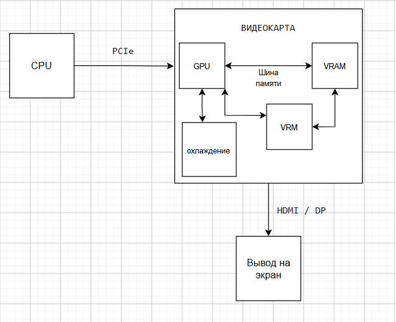

# Домашнее задание: Видеокарта (NVIDIA GeForce MX330)

## Часть 1. Теория (краткие ответы)

**1. Перечислите 5 основных блоков видеокарты и укажите назначение каждого.**
- **GPU (Графический процессор)** — выполняет все вычисления, связанные с графикой (шейдеры, рендеринг).
- **VRAM (Видеопамять)** — хранит текстуры, кадровый буфер и промежуточные данные.
- **Шина памяти** — канал передачи данных между GPU и VRAM, обеспечивает пропускную способность.
- **Подсистема питания (VRM)** — преобразует напряжение +12V в стабильное низкое напряжение для питания GPU и VRAM.
- **Система охлаждения** — отводит тепло от GPU, VRAM и VRM, предотвращая перегрев и троттлинг.

**2. Чем GPU отличается от CPU по архитектуре? Приведите 2 отличия и объясните, для каких задач выгоден каждый.**
- **Архитектура:** CPU имеет небольшое количество сложных ядер (4–16), настроенных на последовательное выполнение задач. GPU имеет тысячи простых ядер, настроенных на параллельные вычисления.
- **Задачи:** CPU выгоден для задач с ветвлениями и сложной логикой (операционная система, работа баз данных, компиляция кода). GPU выгоден для однотипных массивных вычислений (3D-графика, рендеринг видео, нейросети).

**3. Что такое VRAM и чем она отличается от оперативной памяти компьютера? Почему видеопамять делают максимально быстрой?**
- VRAM — это память, расположенная на видеокарте, используемая для хранения графических данных. 
- Отличия от системной RAM: она имеет значительно более широкую шину (у MX330 — 64 бит) и более высокую пропускную способность. Также она распаяна рядом с GPU для минимизации задержек.
- Видеопамять делают максимально быстрой, потому что GPU обрабатывает гигантские объёмы данных параллельно; если память будет медленной, мощные ядра GPU будут простаивать в ожидании данных.

**4. Объясните своими словами, что такое SIMT и зачем GPU группирует потоки в варпы.**
- **SIMT (Single Instruction, Multiple Threads)** — принцип, при котором одна инструкция выполняется сразу множеством потоков (нитей) над разными данными.
- **Варпы** (группы обычно по 32 потока у NVIDIA) нужны для эффективного управления. Группируя потоки, GPU выполняет одну команду для всей группы сразу, что экономит ресурсы контроллера и позволяет максимально загрузить вычислительные ядра.

**5. Зачем видеокарте система охлаждения и подсистема питания? Что произойдёт, если охлаждение не справится?**
- Система питания (VRM) нужна для подачи стабильного напряжения и тока. Охлаждение нужно для отвода тепла.
- Если охлаждение не справится, GPU начнёт перегреваться. Сработает защита — **троттлинг** (сброс частот для снижения температуры), производительность резко упадёт. При сильном перегреве возможны артефакты на экране или аварийное выключение ноутбука.

---

## Часть 2. Схема

**Пояснение к схеме:**
- **CPU ➔ GPU (PCIe):** Процессор передает команды и данные для отрисовки графики через шину PCI Express.
- **GPU ↔ VRAM (Шина памяти):** Графический процессор обменивается данными с видеопамятью (текстуры, кадровый буфер).
- **VRM ➔ GPU/VRAM:** Подсистема питания преобразует напряжение и подает энергию на процессор и память видеокарты.
- **Охлаждение ↔ GPU:** Система охлаждения отводит тепло от нагревающегося графического чипа.
- **Вывод на экран (HDMI/DP):** Сформированный видеосигнал передается на монитор или экран ноутбука.

---

## Часть 3. Практика

**7. Характеристики моей видеокарты (NVIDIA GeForce MX330):**
- **Объём VRAM:** 2 ГБ
- **Тип памяти:** GDDR5
- **Ширина шины:** 64 бит
- **Число ядер (CUDA):** 384
- **TDP:** 25 Вт (в зависимости от ноутбука может быть 12 Вт)

**8. Расчёт пропускной способности памяти:**
- **Формула:** `частота памяти (МГц) × ширина шины (бит) / 8`
- **Расчёт:** `7000 МГц × 64 бит / 8 = 56 000 МБ/с = 56 ГБ/с`
- **Сравнение:** Полученное значение в 56 ГБ/с совпадает с паспортной пропускной способностью для MX330 (GDDR5, 7000 МГц).

**9. Опишите по шагам, что происходит от нажатия «запустить игру» до появления картинки на экране:**
1. **CPU** загружает исполняемый файл игры, подготавливает данные и отправляет первые команды видеокарте через драйвер (шина PCIe).
2. **GPU** получает данные (модели, текстуры) и загружает их в **VRAM**.
3. **GPU** начинает обработку: рассчитывает геометрию, накладывает текстуры и просчитывает освещение, постоянно обмениваясь данными с VRAM через шину памяти.
4. Готовый кадр (изображение) записывается в кадровый буфер в **VRAM**.
5. Видеосигнал передается через порт вывода (HDMI/DP или внутренний шлейф) на матрицу экрана, и вы видите картинку.

---

## Часть 4. Вывод

**10. Почему видеокарты оказались нужны не только для игр, но и для ИИ?**
Видеокарты оказались идеальны для ИИ, потому что нейросети — это огромное число однотипных параллельных операций (например, умножение матриц). GPU с тысячами ядер справляется с такими задачами в разы быстрее CPU. Высокая пропускная способность VRAM позволяет держать в памяти большие объемы данных и сами модели. Именно параллелизм и однородность вычислений сделали GPU главным инструментом для обучения искусственного интеллекта.